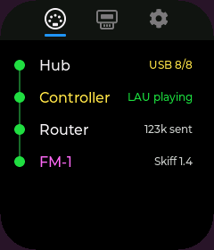
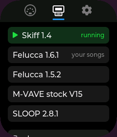
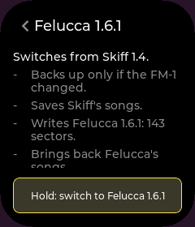

# Outrigger

**Outrigger lets a USB MIDI controller play an M-VAVE FM-1 with no computer, and switches the FM-1's firmware for
you, backing it up first.** It runs on a small ESP32-S3 touchscreen board that sits on a powered USB hub next to the
FM-1: your controller and the FM-1 on the hub, Outrigger on the hub's upstream port, one power supply for all of it.

  
  
  

## Install

**[outrigger.music](https://outrigger.music)** installs it from Chrome or Edge over USB. No toolchain, no downloads to
manage.

## Status

**Beta.** Expect rough edges. Firmware switching writes to your FM-1, so read the
[beta guide](docs/beta/01-what-you-need.md) first, including
[what to do if your FM-1 won't boot](docs/beta/06-if-your-fm1-wont-boot.md) and the
[known issues](docs/beta/07-known-issues.md).

**Boards:** tested on the Waveshare ESP32-S3-Touch-LCD-1.69 and ESP32-S3-Touch-LCD-3.5, with a Novation Launchkey
Mini MK4 37. What else should work, and how to add a board: [docs/boards.md](docs/boards.md).

**Feedback:** feedback@outrigger.music, or open an issue.

## Docs

- [Beta guide](docs/beta/01-what-you-need.md): what you need, installing, switching firmware, backups, recovery.
- [All the docs](docs/README.md), grouped for players, board builders and firmware authors.
- [Contributing](CONTRIBUTING.md): building, testing, and how changes land and ship.

## Built on and alongside

The FM-1 has a lively community, and these are projects we use, learn from or sit next to.

- [Felucca](https://github.com/hugelton/felucca) and [felucca-bsp](https://github.com/hugelton/felucca-bsp) (Hügelton Instruments): a custom FM-1 firmware, and the board support package for JieLi-based M-VAVE synths.
- [fm1-base](https://github.com/charlesvestal/fm1-base), [X0X](https://github.com/charlesvestal/fm1-x0x), [AMB-1](https://github.com/charlesvestal/fm1-amb) and [more FM-1 firmwares](https://github.com/charlesvestal?tab=repositories&q=fm1) (Charles Vestal): a firmware base and template, a groovebox, a generative ambient machine, and others.
- [MvaveFM1Unbricker](https://github.com/Quixotic7/MvaveFM1Unbricker) and [RemoteFM1](https://github.com/Quixotic7/RemoteFM1) (Quixotic7): an FM-1 unbricker, and a player that runs FM-1 firmwares from the browser without installing them.
- [fm1-mirror](https://github.com/pfkellogg/fm1-mirror) (Patrick Kellogg): the FM-1's screen, big, on a computer.
- [fm1buddy](https://github.com/konsumer/fm1buddy) (David Konsumer), a related project: a touchscreen box that runs an FM-1 without a computer.

## License

[GPL-3.0](LICENSE), the license of M-VAVE's `fm1_open`, Felucca, Skiff and SLOOP. [NOTICE](NOTICE) lists the
third-party code inside. No M-VAVE firmware is in this repo; your browser downloads it at install time and checks
each file.
